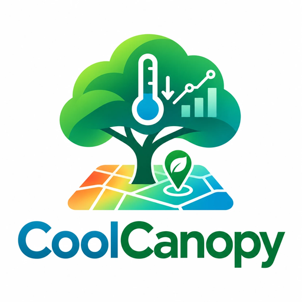

<p align="center"></p>

# CoolCanopy

A tree-planting planner for Houston, built on Databricks. It answers one question: if the city can plant N trees, where should they go to cool the most people who need it most?

CoolCanopy combines Landsat summer surface temperature, NLCD tree canopy, Overture building and road outlines, 2020 Census population and the CDC Social Vulnerability Index on an H3 hexagon grid (105k cells, about 15,000 m² each). A monotone LightGBM model learns how canopy and pavement drive surface heat, and the model's estimates of the cooling from each possible new tree feed a planting optimizer. A planner agent (Llama 4 Maverick on Databricks Foundation Model APIs) turns plain-English requests into plans. Everything is served in a Databricks App, with a Genie space for questions about the data.

## What's in the app
- A map of surface heat, canopy, canopy change, social vulnerability or population, with an optional 3D view where height is residents
- Planting plans from 100 to 50,000 trees, citywide or inside one council district or Super Neighborhood
- Five strategies compared on the same cooling estimates: vulnerable residents first, most residents cooled, hottest cells first, even split by district, and random
- A chat planner ("$250k, about 600 trees, avoid power lines, prioritize Gulfton") that shows its tool calls
- "Beat the algorithm", a game where you place trees yourself and compare against the optimizer
- An FAQ explaining every term

## Run it in your own workspace

Prerequisites:
- A Databricks workspace with serverless compute (Free Edition works)
- The [Databricks CLI](https://docs.databricks.com/dev-tools/cli/install.html), authenticated: `databricks auth login --host <workspace-url> --profile <name>`
- A SQL warehouse named "Serverless Starter Warehouse" (the default on Free Edition), or change the `warehouse_id` lookup in `databricks.yml`
- Access to the `databricks-llama-4-maverick` Foundation Model endpoint

Deploy and run the pipeline:

```bash
export DATABRICKS_CONFIG_PROFILE=<name>   # PowerShell: $env:DATABRICKS_CONFIG_PROFILE="<name>"
databricks bundle deploy
databricks bundle run heat_pipeline
```

Deploy the app. It imports the `heat` package from its own folder, so copy it in first:

```bash
sh scripts/sync_app.sh                    # PowerShell: ./scripts/sync_app.ps1
databricks bundle deploy
databricks bundle run heat_planner
```

Optional: create the Genie space with `python scripts/create_genie_space.py <warehouse_id>`.

### Local development

```bash
python -m venv .venv
.venv/bin/pip install -r requirements-dev.txt      # Windows: .venv\Scripts\pip
.venv/bin/python -m pytest -q
```

To run the dashboard locally, download the exported data and point the app at it:

```bash
databricks fs cp -r dbfs:/Volumes/workspace/heat/artifacts/houston/app data/app
export HEAT_ARTIFACTS="$PWD/data/app" DATABRICKS_WAREHOUSE_ID=<warehouse_id>
sh scripts/sync_app.sh && cd app && streamlit run app.py
```

On Windows, `scripts/run_local.ps1` does the same (set `DATABRICKS_CONFIG_PROFILE` and `DATABRICKS_WAREHOUSE_ID` first).

Agent evaluation: `python eval/run_eval.py` scores 16 manager requests against expected constraints and logs to MLflow.

### Another city
Every city-specific setting (bounding box, Landsat tiles, boundary services, district names, costs) lives in `conf/city_houston.yaml`. `conf/city_nyc.yaml` is a second example. Point the `city_config` bundle variable at a new file and rerun the job.

## Pipeline (Lakeflow Job `heat-pipeline`, serverless)
| Task | Notebook | Output |
|---|---|---|
| setup | `00_setup.sql` | schema, volumes |
| ingest_landsat | `01_ingest_landsat.py` | `bronze_landsat_scenes`, `bronze_landsat_pixels` (15 scenes, 2019–24, 3 WRS tiles) |
| silver_lst_h3 | `02_silver_lst_h3.sql` | `silver_lst_h3`: anomaly vs scene median on path-overlap reference cells |
| ingest_context | `03_ingest_context.py` | `bronze_boundaries` (city limits, council districts A–K as approved 10-12-2022, 88 Super Neighborhoods), `bronze_raster_pixels` (NLCD TCC 2011/16/21, impervious 2021) |
| ingest_footprints | `03b_ingest_footprints.py` | `bronze_obstacles`: Overture Maps buildings + road/rail segments (DuckDB on S3), each with a no-plant buffer in meters |
| silver_gold_hex | `04_silver_gold_hex.sql` | `silver_city_h3`, `silver_landcover_h3`, `gold_hex_features` (+ k=1,2 rings) |
| plantable_space | `04b_plantable_space.sql` | `silver_obstacles_h3`, `silver_plantable_h3` (cell minus buffered obstacles, spatial SQL), `silver_plantable_spots` (res-13 tree spots on open ground) |
| ingest_people | `05_ingest_people.py` | `silver_pop_h3`: 2020 block-group pop, dasymetric by impervious; CDC SVI 2022 shares |
| train_model | `06_train_heat_model.py` | MLflow run, UC model `workspace.heat.heat_model`, `gold_model_*` |
| planting_effects | `07_planting_effects.py` | `gold_planting_sites` (capacity from open spots), `gold_planting_spots`, `gold_planting_effects` (ΔT per tree, 2 rings, 10–90% band) |
| simulate_plans | `08_simulate_plans.py` | `gold_plans`, `gold_plan_picks`, `gold_plan_hex_delta`, `gold_decision_log` |
| agent_tools | `09_agent_tools.sql` | UC functions: `site_details`, `nearest_cell`, `district_summary`, `neighborhood_summary`, `hottest_cells`, `compare_strategies`, `model_card` |
| export_app_data | `10_export_app_data.py` | Parquet for the app in `/Volumes/workspace/heat/artifacts/houston/app` |

## Code
| Path | What |
|---|---|
| `conf/` | City configs (`city_houston.yaml` is the default) |
| `src/heat/landsat.py` | QA masking, DN→°C, windowed COG reads, tile/year-balanced scene picking |
| `src/heat/footprints.py` | Overture DuckDB queries, road buffer widths, open-ground fallback capacity |
| `src/heat/context.py` | ArcGIS polygon fetch (paging, sliver filter), MRLC WCS GeoTIFF fetch |
| `src/heat/model.py` | Monotone LightGBM, spatial GroupKFold by H3 res 6, OLS with clustered SEs, planting effects |
| `src/heat/sim/optimize.py` | Lazy-greedy (CELF) optimizer with quotas, budget, attractors, decision log and uncertainty; baselines; replay |
| `src/heat/game.py` | "Beat the algorithm" scoring on the optimizer's effect table |
| `src/heat/agent/constraints.py` | `PlanConstraints`: coercion of messy tool calls, chips, clarification rules |
| `src/heat/agent/planner.py` | Agent loop: grounding, hard/soft resolution, optimizer tools, UC tools, number check |
| `app/` | Streamlit Databricks App |
| `resources/` | Bundle definitions for the job and the app |
| `eval/` | 16 manager requests with expected constraints; `run_eval.py` logs to MLflow |
| `tests/` | `pytest` (synthetic city, toy optimizer, scripted fake LLM) |

## Results
- Heat model: spatial-CV R² 0.865, MAE 1.24 °C (random CV scores 0.925, which shows how much neighboring cells leak)
- Canopy effect (OLS, clustered SE): −0.51 °C surface per +10 points of canopy in the cell, plus −0.32 °C from the 2-ring neighborhood
- At 5,000 trees, putting vulnerable residents first reaches about 4× more vulnerable residents than planting the hottest cells first, and about 8× more than random placement
- Agent: 16/16 manager requests parsed to the expected constraints

## Known limitations
- Landsat thermal is ~100 m native and captured around 10:30 am. Results are surface, not air, temperature.
- Houston has no full planting-space inventory. Each cell's capacity counts ~16 m-spaced spots on open ground: Overture building footprints (+2 m setback) and roads (buffered by class) are cut out with spatial SQL, and NLCD screens out parking lots and existing canopy. Half of those spots count as plantable (`usable_share`), a placeholder for private yards and utilities.
- There's no overhead-wire, bus-stop or sidewalk data yet. The agent reports these constraints as unsupported instead of claiming to honor them.
- The $1,500 cost per tree is a placeholder.
- Population is assigned to a block group's cells by center containment, so the city total (2.54M) overcounts the 2020 census figure (2.30M) by about 10% at the edges.
- About 14% of cells (edge cells whose center falls outside the district polygons) have no council district.

## License
MIT, see [LICENSE](LICENSE).
